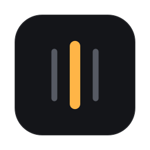

<p align="center">
  
</p>

<h1 align="center">AltTab</h1>

<p align="center">
  <b>Option+Tab para macOS que enxerga os workspaces do AeroSpace, as abas do Edge e a música que está tocando.</b><br>
  Um painel de vidro, com miniatura de cada janela e de cada aba, busca, e um mini player do YouTube Music.
</p>

<p align="center">
  
  
  
  
</p>

---

## Por que existe

O Cmd+Tab do macOS troca de **app**, não de janela, e não sabe nada de abas nem de workspaces.
Com o [AeroSpace](https://github.com/nikitabobko/AeroSpace) organizando as janelas em workspaces e o Edge
cheio de abas, achar "aquela" janela ou aba virava caça ao tesouro. O AltTab mostra **tudo de uma vez**, do
jeito que está organizado, e leva você lá em um gesto.

## O que ele faz

**Alternador**
- **Option+Tab** abre o painel com a **janela anterior** já selecionada — um toque rápido volta para onde você estava.
- Uma **coluna por workspace** do AeroSpace; a coluna em foco abre mais larga, o workspace atual vem marcado.
- **Miniatura de cada janela**, inclusive das que estão em workspaces escondidos.
- Cartões que **inclinam em 3D** seguindo o mouse, com brilho no ponto do ponteiro.
- **Busca**: digite (ou aperte `/`) e só ficam as janelas e abas que batem — no título, no app ou no domínio, sem ligar para acentos.
- **Fechar** a janela ou aba selecionada (X ou Option+W).

**Abas do Edge**
- Cada aba vira um item próprio, na coluna do workspace da janela do Edge, com **miniatura**, ícone do site, indicador de **áudio** e "visto há X".
- Fora de foco: as 3 mais recentes + um cartão "+N". Em foco: **destaque grande** da aba selecionada + **grade fixa** de miniaturas que cabe sem rolagem (e não se mexe com o mouse).
- Escolher uma aba leva ao Edge **naquela aba**.

**Player do YouTube Music**
- Pílula compacta **tingida com a cor da capa** do álbum, com visualizador, progresso e anterior / tocar-pausar / próxima.
- Clicar na **capa** faz ela girar e crescer até virar um player completo; clicar na pílula leva para a aba da música.
- Mexer no player não troca de janela ao soltar o Option.

**De quebra:** saudação "Bom dia / Boa tarde / Boa noite" com a foto da sua conta do macOS e vidro de verdade (Liquid Glass).

## Atalhos

| Tecla (com o painel aberto) | O que faz |
|---|---|
| **Option+Tab** | Abre o painel / vai para o próximo |
| **Option+Shift+Tab** | Vai para o anterior |
| Soltar **Option** | Vai para a seleção (se você não digitou nem mexeu no player) |
| **← →** | Workspace anterior / próximo |
| **↑ ↓** | Janela ou aba dentro do workspace |
| **1–9** | Pula para o workspace |
| **/** ou **espaço** | Ativa a busca (o painel fica aberto ao soltar o Option) |
| Qualquer letra | Filtra; o painel fica fixo — **Enter** vai, **Esc** cancela |
| **Option+W** | Fecha a janela ou aba selecionada |
| **Esc** | Fecha sem trocar |

## Instalação

**Requisitos:** macOS 26 ou mais novo, Xcode com Swift 6, [AeroSpace](https://github.com/nikitabobko/AeroSpace) (CLI em `/opt/homebrew/bin/aerospace`), Microsoft Edge e Node (só para os testes da extensão).

```bash
git clone https://github.com/tomalvess96/alttab.git
cd alttab
./scripts/install.sh
```

O script compila, assina, copia para `~/Applications/AltTab.app`, registra a ponte com o Edge e abre o app.

**Na primeira vez:**
1. Conceda **Acessibilidade** (para o Option+Tab) e **Gravação de Tela** (para as miniaturas) ao AltTab — o menu da barra mostra o que falta. Depois de conceder, saia pelo menu e abra de novo.
2. Carregue a extensão: `edge://extensions` → **Modo de desenvolvedor** → **Carregar sem compactação** → pasta `extension/`. O ID tem que ser `npgoecidghckmkdhakalhchnaebjdhlc`.
3. No menu do AltTab, marque **Iniciar com o Mac**.
4. Se você usa `alt-tab` no AeroSpace, tire do `~/.aerospace.toml` (o AltTab chega antes, mas assim fica limpo).

> **Assinatura.** O `scripts/build-app.sh` assina com o certificado *Apple Development* indicado em `ALTTAB_SIGN_ID`
> e a ponte confere o time `8R7M224T7Y` em `Sources/AlttabCore/PeerIdentity.swift`. Para usar com outro
> certificado, troque os dois.

## Como funciona

```
 ┌──────────── AltTab.app (Swift, barra de menu) ────────────┐
 │  HotkeyMonitor ── CGEventTap: Option+Tab e teclas do painel │
 │  WindowStore ──── CLI do AeroSpace (janelas, foco, fechar)  │
 │  WindowThumbs ─── ScreenCaptureKit + cache                  │
 │  BrowserBridge ── socket Unix ◄──────────────┐              │
 │  SwitcherPanel ── NSPanel + SwiftUI + Liquid Glass          │
 └──────────────────────────────────────────────┼──────────────┘
                                                │  quadros de 4 bytes + JSON
                       alttab-host ─────────────┘  (assinaturas conferidas dos dois lados)
                            ▲ Native Messaging (stdin/stdout)
 ┌──────────── Extensão do Edge (MV3) ──────────────────────────┐
 │  background.js ── abas, foto da aba visível, ativar/fechar   │
 │  content.js ───── YouTube Music: o que toca + botões         │
 └──────────────────────────────────────────────────────────────┘
```

- **Toda a lógica testável** (modelo do alternador, máquina de estados do teclado, ligação aba → janela, layout,
  cor da capa, protocolo, socket, filtros de segurança) fica em `Sources/AlttabCore`, sem AppKit.
- O **tap de teclado** só decide e devolve; o trabalho de tela vai para a fila principal depois — o teclado do
  sistema nunca espera o painel. Um "Option solto" que o macOS perdeu é corrigido pelo estado real de cada tecla.
- As **abas** entram no lugar da janela do Edge na ordem de uso; com o Edge na frente, o Option+Tab rápido pula as
  outras abas e vai para a janela anterior.

## Segurança e privacidade

- A ponte só conversa com processos **assinados pelo mesmo time** (verificação de assinatura dos dois lados do
  socket); a pasta do socket é `0700`.
- O app **nunca baixa** nada que uma página indique: o ícone das abas vem do cache do próprio Edge, e a capa do
  álbum só de uma lista fechada de domínios do Google, sem seguir redirecionamento para fora dela.
- **Fotos das abas** ficam só na memória da sessão do Edge (somem ao fechá-lo), nunca no disco e nunca de abas anônimas.
- Imagens recebidas são só JPEG/PNG e já decodificadas reduzidas.

## Desenvolvimento

```bash
./scripts/test.sh                     # testes Swift (145)
cd extension && node --test lib.test.js   # testes da extensão (13)
./scripts/build-app.sh                # compila e assina o .app
./scripts/install.sh                  # instala e reinicia app + ponte
swift scripts/make-icon.swift <pasta> # regera o ícone (iconutil -c icns <pasta>)
```

> Os scripts compilam em `~/Library/Caches/alttab-build`: dentro de pastas sincronizadas (OneDrive, iCloud)
> o File Provider grava atributos estendidos e o `codesign` recusa.

Mudou algo em `extension/`? Recarregue a extensão em `edge://extensions` — ela reinjeta o script nas abas do
YouTube Music já abertas.

```
Sources/AlttabCore/   lógica pura + testes em Tests/AlttabCoreTests
Sources/AlttabApp/    app (AppKit + SwiftUI)
Sources/AlttabHost/   ponte Native Messaging
extension/            extensão do Edge
```

## Limitações conhecidas

- O painel não aparece por cima de **jogo em tela cheia**.
- O Edge só deixa fotografar a **aba visível**: aba que você ainda não abriu desde que o Edge iniciou aparece com o ícone até ser vista uma vez.
- A ponte atende **um perfil** do Edge por vez.
- Os botões do YouTube Music são achados pelo nome; se o site mudar de novo, ajuste `extension/content.js`.

---

<p align="center"><sub>Feito por Tom Alves · projeto pessoal</sub></p>
